<div align="center">


# Sakhi

**Walk freely. Your community has your back.**

A women's safety app: anonymous place reviews, a live safety map, one-tap SOS that works without internet,<br/>
and a journey check-in that sends help even when her phone dies.

[](https://nodejs.org)
[](https://react.dev)
[](#-features)
[](https://www.openstreetmap.org)
[](#-testing)
[](LICENSE)

Hackathon team repository for NGNIX - [hackindia-team:t-hacks-90:ngnix]

[Problem](#-the-problem) ·
[Screens](#-screens) ·
[Features](#-features) ·
[How it works](#%EF%B8%8F-how-it-works) ·
[Quick start](#-quick-start) ·
[API](#-api-reference) ·
[Roadmap](#%EF%B8%8F-roadmap)

</div>

---

## 🚨 The problem

India recorded **4,45,256 crimes against women in 2022** ([NCRB, *Crime in India 2022*](https://ncrb.gov.in)). Safety apps fail her in three ways:

| | Today | Sakhi |
|---|---|---|
| ⏱️ **Too late** | A panic button needs her to act during the attack. | The **journey check-in** sends the SOS for her when she stops responding. |
| 📵 **Too fragile** | No internet or no battery means no help. | **SMS fallback** works without data. The **server** raises the SOS even when the phone is off. |
| 🙈 **Too blind** | Nothing warns her before she walks into a risky area. | **Community reviews** and a **live safety map** show which streets feel safe. |

Two pillars: **crowdsourced intelligence** (avoid danger before it happens) and **automated failsafes** (help comes even if she cannot act).

---

## 📱 Screens

<table>
  <tr>
    <td align="center">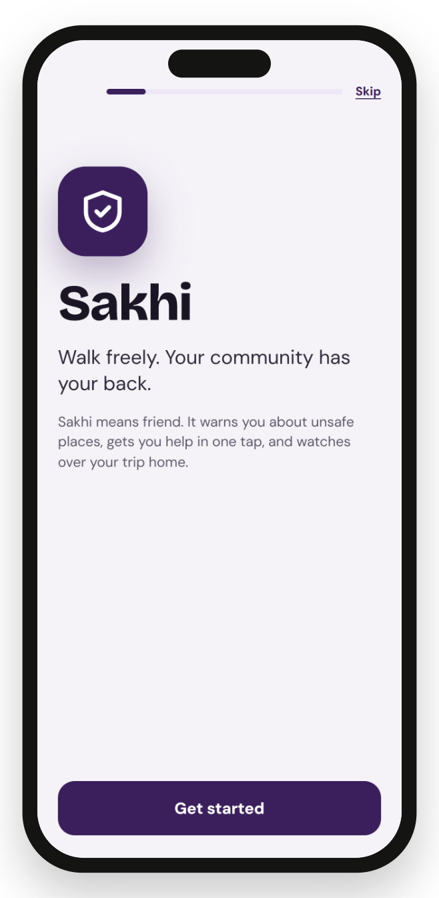<br/><b>Onboarding</b><br/><sub>Six steps, ends with a practice SOS</sub></td>
    <td align="center">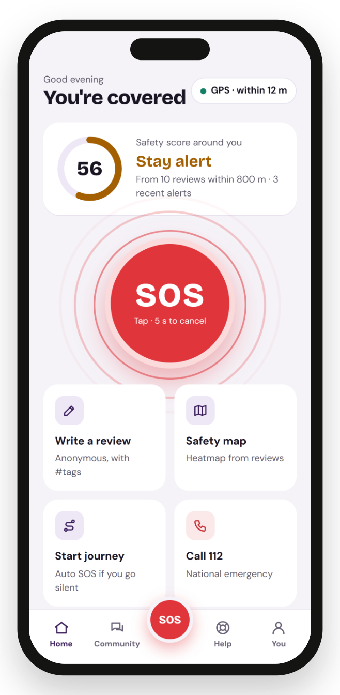<br/><b>Home</b><br/><sub>Safety score around you, one-tap SOS</sub></td>
    <td align="center">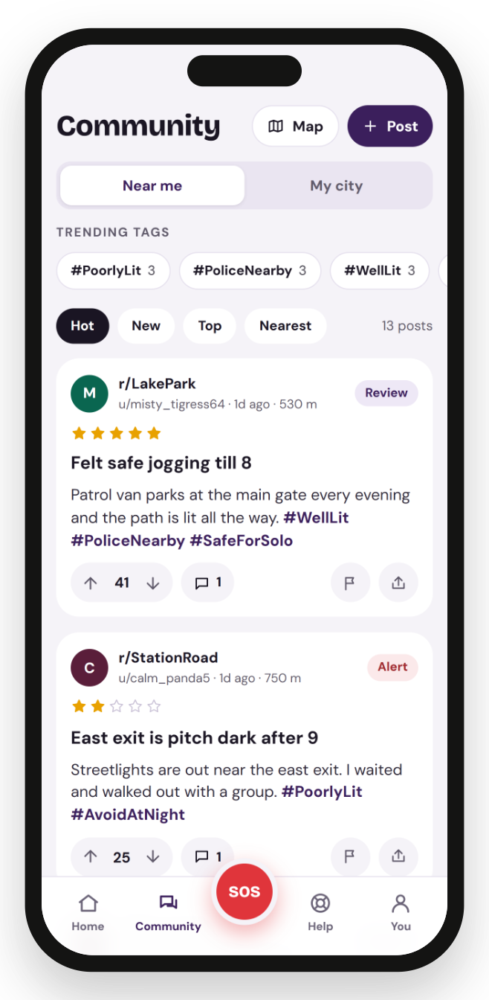<br/><b>Community</b><br/><sub>Anonymous reviews with #hashtags</sub></td>
  </tr>
  <tr>
    <td align="center">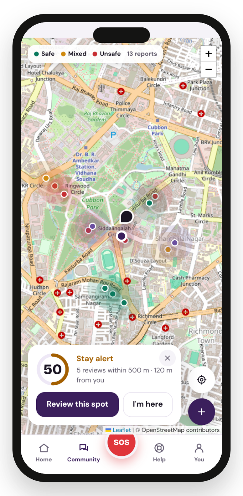<br/><b>Safety map</b><br/><sub>Heatmap and a score for any spot</sub></td>
    <td align="center">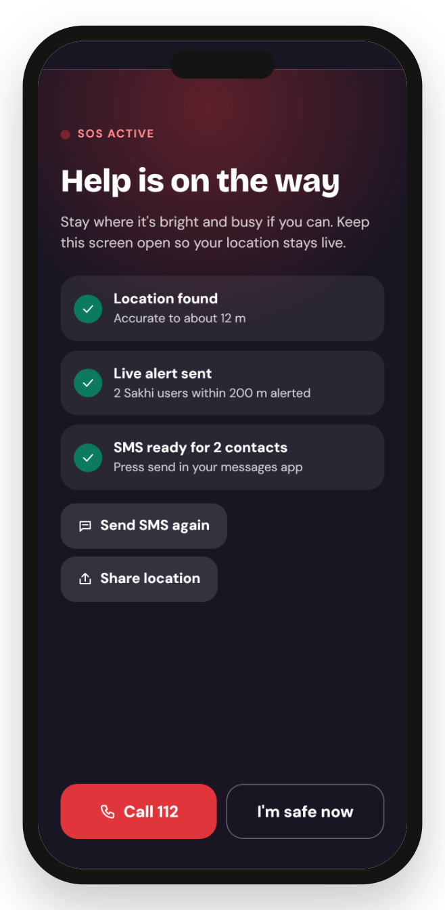<br/><b>SOS</b><br/><sub>Location, live alert, SMS to contacts</sub></td>
    <td align="center">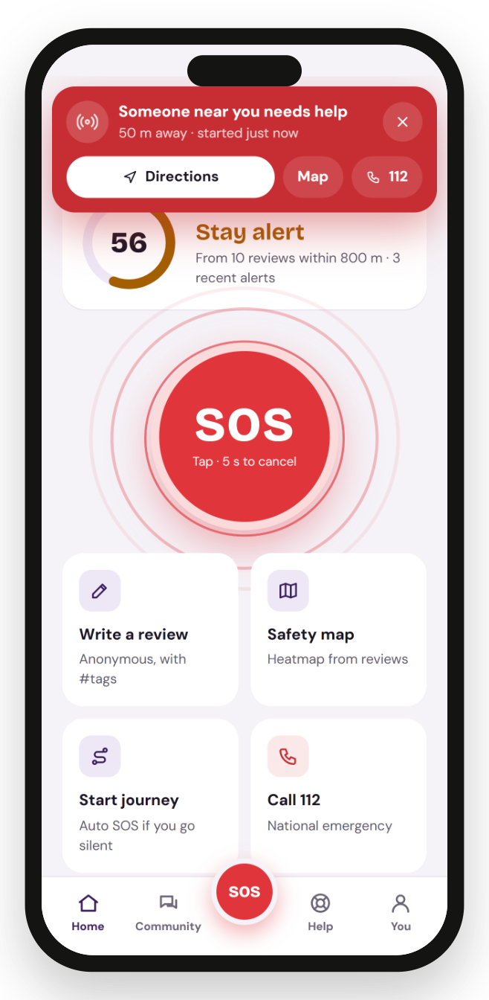<br/><b>Nearby alert</b><br/><sub>A user 50 m away gets the SOS</sub></td>
  </tr>
  <tr>
    <td align="center">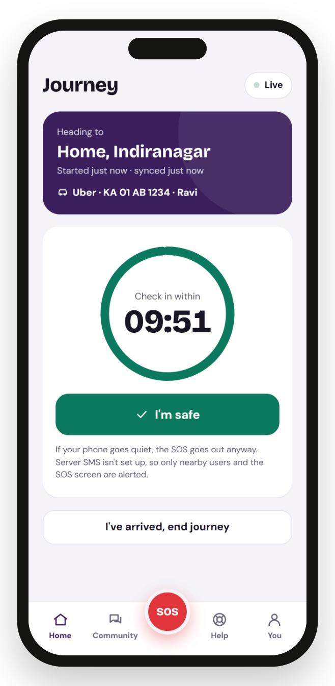<br/><b>Journey</b><br/><sub>Check-in timer with cab details</sub></td>
    <td align="center">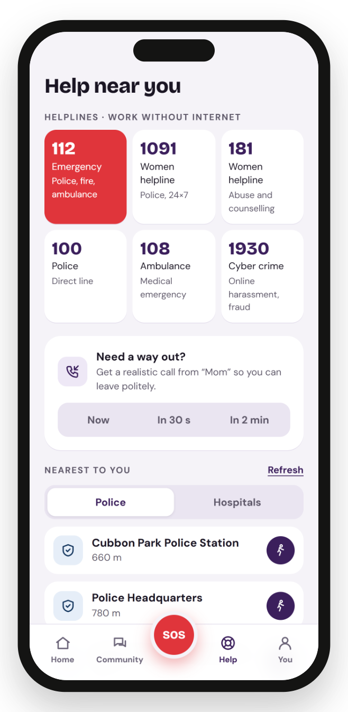<br/><b>Help</b><br/><sub>Helplines, nearest police, walking route</sub></td>
    <td align="center">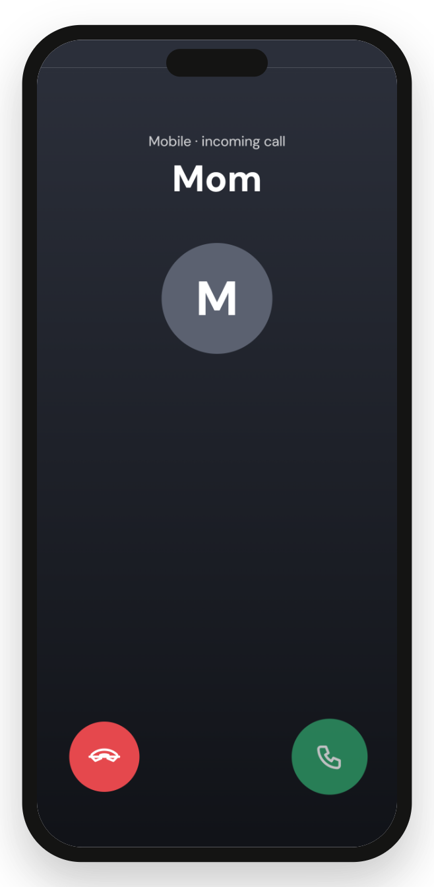<br/><b>Fake call</b><br/><sub>A polite way to leave</sub></td>
  </tr>
</table>

---

## ✨ Features

<details open>
<summary><b>🗺️ Community and safety map</b>: know the street before you walk</summary>

- Post a **Review**, **Alert** or **Tip** about a place, with a 1–5 star safety rating.
- Add `#hashtags` such as `#WellLit`, `#PoorlyLit`, `#PoliceNearby`, `#SafeForSolo`. Tap any tag to filter the feed.
- Vote, reply, and sort by **Hot**, **New**, **Top** or **Nearest**. Trending tags show the risks near you.
- Place names fill in by themselves from OpenStreetMap.
- **Safety score 0–100** for any spot: closer and newer reviews count more. The map shows it as a heatmap.
- **Anonymous**: no account and no phone number. Each phone gets a pseudonym like `u/calm_otter42`.
- **Moderation**: report a post with a reason. A post with 3 reports is hidden.

</details>

<details>
<summary><b>🆘 One-tap SOS</b>: help in seconds, even with no data</summary>

- Tap SOS. A **5-second countdown** lets her cancel a false alarm.
- Her trusted contacts get an **SMS with a map link**. A plain SMS works with no internet.
- Every Sakhi user **within 200 m** gets an alert with directions, **even when their app is closed** (Web Push).
- Her family gets a **live tracking link** that updates every 15 seconds.
- **Practice mode** runs the same screens but alerts nobody.

</details>

<details>
<summary><b>🧭 Journey: the dead-man's switch</b>: help comes even if her phone dies</summary>

1. **Log it**: she names her destination and can add cab details (service, number plate, driver).
2. **Track it**: she taps **I'm safe** once every 10 minutes. Her phone buzzes 1 minute before the deadline.
3. **Trigger it**: no check-in, so the **server** raises the SOS on its own. This works with the phone switched off.

The cab details go out with every SOS message.

</details>

<details>
<summary><b>🚓 Help near you</b>: police, hospitals, helplines, fake call</summary>

- Indian helplines **112, 1091, 181, 100, 108, 1930** are built into the app, so they work offline.
- The nearest **police stations** (women's desks marked when OpenStreetMap names them) and **hospitals**.
- A **walking route** to any of them, drawn on the map.
- **Fake call**: a realistic incoming call now, in 30 s or in 2 min, with a ringtone and a spoken voice.

</details>

<details>
<summary><b>📶 Works offline</b></summary>

Sakhi is an installable **PWA**. After the first visit, the app opens with no network at all. The SOS screen, the SMS fallback and the helplines all keep working. Recently viewed map areas also stay cached.

</details>

---

## ⚙️ How it works

### SOS flow

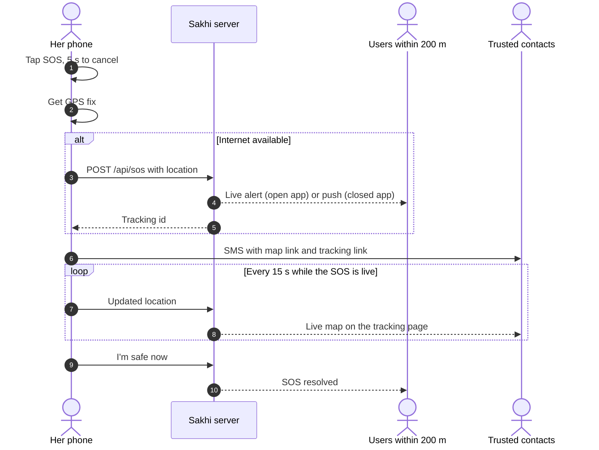

### Journey dead-man's switch

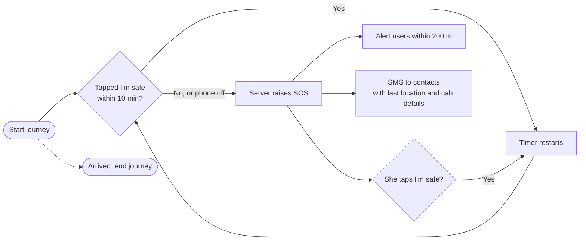

### Architecture

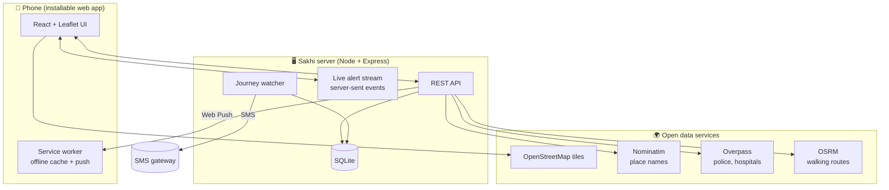

---

## 🚀 Quick start

Needs **Node 22.13 or newer** (Sakhi uses Node's built-in SQLite, so there is no database to install).

```bash
git clone https://github.com/HackIndiaXYZ/t-hacks-90-ngnix.git
cd t-hacks-90-ngnix
npm install
npm run seed
npm run dev
```

Open **http://localhost:5173**. The API runs on port 8787 behind the dev server.

<details>
<summary><b>🧪 Try the full demo in 3 minutes</b></summary>

1. Go through **onboarding** and add one trusted contact. Finish with the **practice SOS**.
2. Open **Community**, tap **Post**, rate a place and add `#WellLit`. Open **Map** and see the score change.
3. Open a **second browser window** (or a private window), pin it within 200 m of the first one, then tap **SOS** in the first window. The second window gets the alert.
4. Start a **journey** with the fast timer to watch the auto-SOS:
   ```bash
   SAKHI_JOURNEY_TIMEOUT_MS=90000 npm run dev
   ```
   Don't tap **I'm safe**. After 90 seconds the server raises the SOS by itself.
5. Open **Help**: call buttons, nearest police stations and a walking route. Try **Fake call → Now**.

</details>

<details>
<summary><b>📦 Production build</b></summary>

```bash
npm run build
npm start
```

The server serves the app and the API together on `PORT` (default 8787). Data is in `data/sakhi.db`.
Phones need **HTTPS** for GPS, push and offline install: deploy it, or use a tunnel such as
`cloudflared tunnel --url http://localhost:8787`.

Add sample posts around your own area with `npm run seed -- <lat> <lng>`.

</details>

---

## 📚 API reference

Every request that writes data sends an `X-Device` header (a random id kept on the phone). The server stores only a keyed hash of it.

<details>
<summary><b>Community and map</b></summary>

| Method | Path | What it does |
|---|---|---|
| `GET` | `/api/posts?lat&lng&radius&sort&tag&place` | Posts near a point. `sort` = `hot`, `new`, `top`, `near` |
| `POST` | `/api/posts` | New post: `lat, lng, place, flair, rating, title, body` |
| `DELETE` | `/api/posts/:id` | Delete your own post |
| `POST` | `/api/posts/:id/vote` | `value` = `1`, `-1` or `0` |
| `GET` / `POST` | `/api/posts/:id/comments` | Read or add replies |
| `POST` | `/api/posts/:id/flag` | Report: `harassment`, `false`, `personal`, `spam`, `other` |
| `GET` | `/api/tags/trending?lat&lng` | Top hashtags nearby |
| `GET` | `/api/places?lat&lng` | Known places nearby |
| `GET` | `/api/safety?lat&lng&radius` | Safety score 0–100 and level |
| `GET` | `/api/points?lat&lng&radius` | Points for the heatmap |

</details>

<details>
<summary><b>SOS, journeys and live alerts</b></summary>

| Method | Path | What it does |
|---|---|---|
| `POST` | `/api/sos` | Start an SOS at `lat, lng`. Alerts users within 200 m |
| `PATCH` | `/api/sos/:id` | Update the live location |
| `POST` | `/api/sos/:id/resolve` | I'm safe |
| `GET` | `/api/sos/:id` | Public data for the tracking page |
| `POST` | `/api/journeys` | Start: `dest, lat, lng, contacts, ride` |
| `GET` | `/api/journeys/active` | Your live journey |
| `POST` | `/api/journeys/:id/beat` | Heartbeat. With `checkin: true` it restarts the timer |
| `POST` | `/api/journeys/:id/end` | Arrived. Deletes the stored contact numbers |
| `GET` | `/api/stream?client&device` | Server-sent events: `sos`, `sos-update`, `sos-resolved`, `post` |
| `POST` | `/api/presence` | Tell the stream where you are (never shown to others) |
| `GET` | `/api/push/key` | Web Push public key |
| `POST` | `/api/push/subscribe` / `unsubscribe` | Turn nearby alerts on or off |

</details>

<details>
<summary><b>Places, help and routes (OpenStreetMap)</b></summary>

| Method | Path | What it does |
|---|---|---|
| `GET` | `/api/geo/reverse?lat&lng` | Street or landmark name for a spot |
| `GET` | `/api/geo/search?q&lat&lng` | Place search near you |
| `GET` | `/api/help/nearby?lat&lng&radius` | Nearest police stations and hospitals |
| `GET` | `/api/route?from=lat,lng&to=lat,lng` | Walking route: distance, time and line |

</details>

---

## 🔧 Configuration

<details>
<summary>Environment variables</summary>

| Variable | What it does |
|---|---|
| `PORT` | Port for `npm start` (default 8787) |
| `SAKHI_SECRET` | Key for hashing device ids. **Set a long random value in production** |
| `PUBLIC_URL` | Public address, used for the live link in server-sent SMS |
| `SMS_PROVIDER=twilio`, `TWILIO_SID`, `TWILIO_TOKEN`, `TWILIO_FROM` | Lets the server text contacts on a journey auto-SOS. Without them the SMS is only logged. Indian numbers need DLT registration |
| `VAPID_PUBLIC_KEY`, `VAPID_PRIVATE_KEY`, `VAPID_SUBJECT` | Web Push keys. If unset, a key pair is made once and stored in the database |
| `SAKHI_JOURNEY_TIMEOUT_MS` | Check-in window (default 600000 = 10 min) |
| `NOMINATIM_URL`, `OVERPASS_URL`, `OSRM_FOOT_URL`, `OSM_USER_AGENT` | Use your own OpenStreetMap services |
| `SAKHI_DATA_DIR` | Folder for the SQLite database (default `data/`) |

</details>

---

## 🧪 Testing

```bash
npm test
```

The tests start a real server on a throwaway database and check:

- ✅ posts, hashtags, votes, replies and the radius filter
- ✅ the safety score from ratings
- ✅ a post with 3 reports is hidden, and only from other users
- ✅ an SOS reaches a phone 90 m away and not one 1.1 km away
- ✅ a missed check-in raises the SOS by itself, and **I'm safe** restarts the journey
- ✅ push subscriptions and input checks

---

## 🔒 Privacy and safety

- **No account, no phone number.** The server keeps only a keyed hash of each device id.
- **Other users never see where you are** unless you send an SOS.
- **Trusted contacts stay on your phone.** For a journey, the server keeps them only until it ends.
- **Nearby alerts are opt-in.** To reach you, the server keeps the last place your app was open; turn it off any time.
- Posts are pinned to the place being reviewed, rounded to about 10 m.
- Sakhi helps you get help faster. **It does not replace the police. In danger, call 112.**

---

## 🧩 Built with open source

| Part | Project | Licence |
|---|---|---|
| UI | [React](https://react.dev), [Vite](https://vitejs.dev) | MIT |
| Maps | [Leaflet](https://leafletjs.com), [OpenStreetMap](https://www.openstreetmap.org) tiles | BSD-2, ODbL |
| Place names | [Nominatim](https://nominatim.org) | ODbL data |
| Police and hospitals | [Overpass API](https://overpass-api.de) | ODbL data |
| Walking routes | [OSRM](https://project-osrm.org) | BSD-2, ODbL data |
| Offline and push | [Workbox](https://developer.chrome.com/docs/workbox), [web-push](https://github.com/web-push-libs/web-push) | MIT |
| Server | [Express](https://expressjs.com), Node built-in SQLite | MIT |

The public OpenStreetMap services are shared resources. Sakhi caches their answers, rate-limits requests and keeps Nominatim to one request per second.

---

## ⚠️ Known limits

- **Sending the SOS SMS needs one tap.** Browsers fill in the message but cannot press Send. Automatic SMS needs a native Android app.
- **iPhone push** works only after the user adds Sakhi to the Home Screen (iOS 16.4+).
- **OpenStreetMap can be incomplete.** Some police stations or women's desks may be missing. The first help search in a new area can take about 20 seconds.

---

## 🛣️ Roadmap

- [x] Anonymous community with hashtags, votes, replies and reports
- [x] Live safety score and heatmap
- [x] One-tap SOS with SMS fallback and 200 m alerts
- [x] Journey dead-man's switch with server-side SOS
- [x] Nearest police and hospitals with walking routes
- [x] Fake call
- [x] Works offline and sends push alerts
- [ ] Native Android app for automatic SMS
- [ ] Cab check against challan records
- [ ] Safe-route suggestions that avoid low-score streets
- [ ] Voice SOS and scream detection

---

<div align="center">

**Team NGNIX** · HackIndia · [MIT License](LICENSE)

*Sakhi means friend.*

</div>
